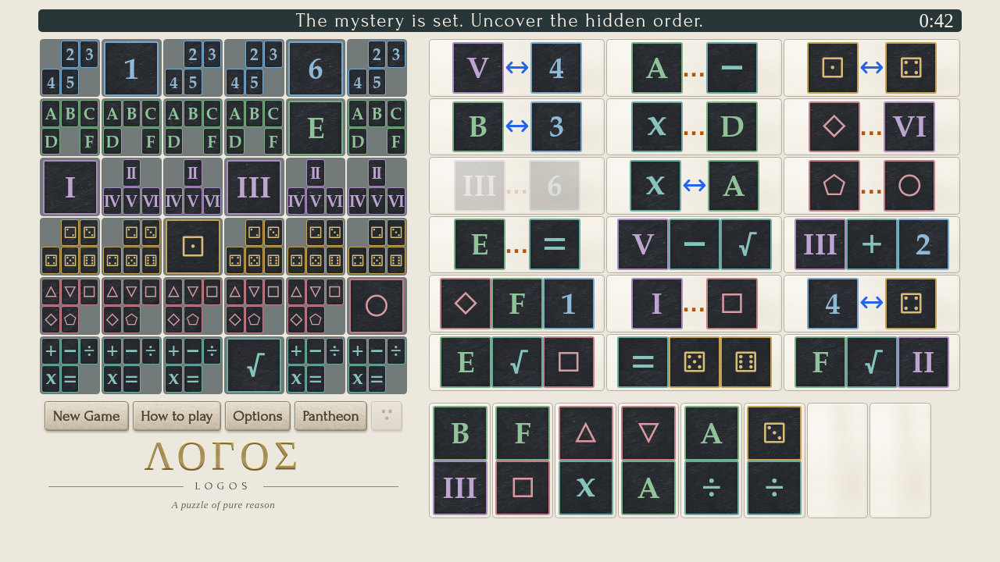

Logos
=====

Logos is a browser-based logic puzzle inspired by the "Einstein" puzzle
game. The version I have played is made by Flowix Games, but that is
apparently a port of an old DOS game called "Sherlock". Logos takes its
gameplay from the Flowix version, but the code was written from scratch.

Build/Install
=============

There is no build or install step. You should be able to view
`index.html` directly in a browser. Instructions are provided within the
game page itself.

Tests
=====

Run `./test` for the core suite, or `./test all` for all suites.
See `./test --help` for prerequisites and selecting individual suites.

Puzzle links
============

Append `#seed=1234abcd` to the page URL to link to a particular puzzle
(seeds are up to 8 hexadecimal digits). Choose "Accept" to begin it.

Daily puzzles
=============

Open `#daily` (or choose "Today's puzzle" in Options) to open the daily
puzzle, or browse to previous daily puzzles. Use `#daily=20261008` to
link to a previous date's puzzle.

Licensing
=========

The code is [MIT-licensed](LICENSE). Bundled fonts have separate licenses;
see [font credits and licenses](fonts/README.md).
